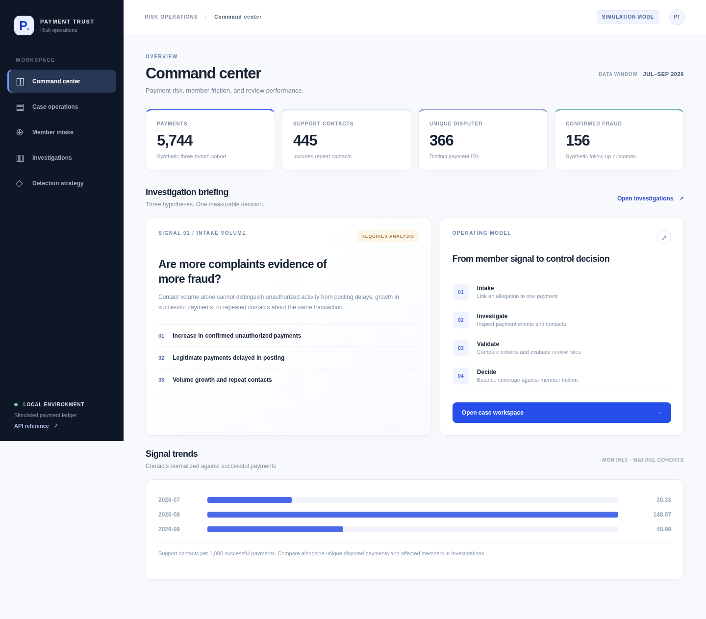

# Payment Trust Lab

**Independent portfolio project: fraud analytics for a synthetic credit-card bill-pay product.** Inspired by publicly described fraud analytics engineering responsibilities. Not affiliated with CRED or any bank. No real payments, people, or incidents are represented here.

## Try the demo

- **[Live Vercel demo](https://payment-trust-lab.vercel.app/demo):** Explore seeded payment disputes, review transaction timelines, and compare fraud rules on synthetic data. The hosted demo is read-only.
- **[Product walkthrough video](docs/payment-trust-product-demo.mp4):** See the local workflow from member complaint to analyst decision. Use local setup below to create complaints and save dispositions yourself.

## One-minute setup

Requires **Python 3.10+**. From the project root:

```bash
python -m venv .venv
# Windows PowerShell: .venv\Scripts\Activate.ps1
# macOS/Linux: source .venv/bin/activate
python -m pip install -r requirements-dev.txt
python -m app.seed
python -m uvicorn app.main:app --reload
```

Open **http://127.0.0.1:8000/demo**. API docs: **/docs**. Liveness: **/health**; database readiness: **/ready**.

`python -m app.seed` is **safe to re-run**: if the synthetic database is already populated, it leaves any new complaints and analyst decisions untouched. To intentionally rebuild the fixed dataset, **stop the server**, back up any decisions you want to keep, then run `python -m app.seed --reset`. Reset deletes the local SQLite database and all manually recorded cases. The database file is not committed to Git.

**Before publishing or presenting**, run these checks:

```bash
python -m app.smoke     # Complete API journey on a disposable database; no changes to your data
python -m pytest -q    # Regression and edge-case tests
python -m app.report   # Recompute the decision memo from synthetic data
```

The latest audited build passed **19 automated tests** and a browser UI workflow (with API calls bridged to the FastAPI application because direct browser localhost requests were blocked in the audit environment). Automated tests and the smoke script should be re-run on each machine; these results are not a guarantee of production availability.

**Frontend preview:**



## Why this project exists

A member reports an unrecognised credit-card bill payment. Support captures their statement and links it to a payment after explicit selection. Analysts examine the complete payment event trail, distinguish repeat contacts from distinct disputed payments, and record a separate disposition. The dataset includes three confounded forces: increased true synthetic fraud, an August posting-delay incident, and payment-volume growth. Rules are evaluated on a later mature September holdout using **only payment-time features**.

### Local demo flow

1. **Member support:** Open **Member intake**, search the prepopulated synthetic member, select a payment, and file a complaint. Omission of payment selection returns HTTP 409 with candidates.
2. **Case operations:** Open any complaint; inspect payment, event IDs, prior contacts, and the recorded analyst disposition history. The synthetic evaluation outcome is collapsed behind a disclosure to keep evidence and the answer key distinct. Record a rationale-backed human disposition; it is append-only and never silently rewrites outcome labels.
3. **Investigations:** Compare July–September cohorts. Observe ticket inflation during delayed posting and higher transaction volume. Explore flow segmentation and loss-per-payment-value.
4. **Detection strategy:** Compare a payment-time baseline with baseline plus an additional velocity-based rule, including known fraud, genuine reviews, unresolved reviews, precision, recall, historical confirmed net-loss coverage, and busiest day compared with a fixed review budget.
5. **Recommendation:** Shadow trial the new rule before any member-facing enforcement, subject to the measured results and operational capacity.

## Data and evaluation contracts

| Table | One input row means | Event time or label time |
| --- | --- | --- |
| `payments` | One submitted synthetic payment | `created_at` |
| `payment_events` | One payment lifecycle event | `occurred_at` |
| `complaints` | One member contact; repeats are separate rows | `created_at` |
| `outcomes` | One synthetic retrospective follow-up outcome per payment | `available_at` |
| `dispositions` | One human case decision; history is append-only | `decided_at` |

`outcomes` is intentionally separate from `complaints` and `dispositions`. An allegation isn't proof. The synthetic outcomes simulate follow-up evidence and are **not** accessible to `baseline()` or `proposed()`; neither function references complaint IDs, decisions, post-payment event time, or future labels.

### Data generation and planted hypotheses

- July: lower synthetic traffic and no designated posting-delay incident.
- August: more traffic plus a concentrated credit-card bill posting-delay incident causing genuine members to make extra contacts.
- September: higher traffic and an increased synthetic propensity for fraud among some payment-time patterns.
- Legitimate payments can have multiple prior bills, producing false positives in a velocity-based rule.
- Repeated contacts about one payment create multiple complaint rows but only one disputed payment.
- An unresolved payment and labels arriving weeks after initial payment are included.

These patterns live in **`app/seed.py` only** and are not exported into payment features as scenario flags. The seed code is intentionally visible for reproducibility, but the rule engine does not use its hidden scenario decisions.

### Definitions and denominators

- **Tickets:** count of complaint rows, including repeat contacts.
- **Unique disputed payments:** count of distinct payments with at least one complaint; a report is not confirmation.
- **Affected members:** distinct member IDs associated with complaints.
- **Contacts per 1,000 successful payments:** all contacts linked to the payment cohort, divided by the number of successful payments in that cohort, times 1,000. Pending transactions can generate contacts but are not in the successful denominator—this is disclosed to avoid confusion.
- **Confirmed net loss basis points:** available confirmed net loss (in paise) / successful payment value (in paise) * 10,000. Uses label **availability as of 2026-11-25 and within 45 days of the originating payment** and payment cohort date, not complaint date.
- **Maturity:** payment date no later than `as_of - 45 days` **and** only contacts and labels arriving within the first 45 days after each payment count toward comparisons. This gives cohorts the same observation window rather than just the same minimum maturity. It does not eliminate missing/unresolved labels or confounding.
- **Precision:** confirmed fraud / (confirmed fraud + verified genuine) among reviewed **resolved** September payments with labels available within 45 days and by snapshot date.
- **Recall:** confirmed fraud reviewed / all confirmed fraud with a label in the 45-day window among successful September payments. This is observed-label recall, not total true-fraud recall.
- **Unresolved:** tracked separately and not silently treated as genuine.
- **Additional fraud:** confirmed outcomes reviewed by the combined rule but not by the baseline. Neither historical covered loss nor extra detections prove actual prevented loss.
- **Daily budget:** 18 reviews per day, measured against busiest daily alerts, not just the mean.

### SQL investigation examples

- `sql/01_spike_investigation.sql`: aggregate payment grain; one output row per payment-month; ticket numerator vs successful payment denominator. Duplicate contacts inflate ticket count intentionally but never payment amount.
- `sql/02_join_trap.sql`: shows the **incorrect** payments × complaints × events join, which multiplies payment value; replaces it with `EXISTS` so each payment enters the sum once.
- `sql/03_loss_and_maturity.sql`: output row per payment-month, successful-value denominator, known label availability as-of snapshot. Late confirmations can understate recent periods unless maturity and unresolved populations are disclosed.

Run the SQL directly using any SQLite client after seeding. Analysis API (`/api/investigation`) uses documented parameterized SQL in `app/analytics.py`. There is no ORM or paid LLM requirement, intentionally.

## Architecture

```text
app/db.py          SQLite schema and connection
app/seed.py        Deterministic synthetic scenarios (answer generation separated)
app/main.py        FastAPI API: support, cases, dispositions, liveness and readiness
app/analytics.py   SQL investigation + payment-time rule evaluation
static/            Vanilla HTML/CSS/JavaScript analyst interface
sql/               Reproducible fraud analytics SQL exercises
tests/             Focused API, case lifecycle, leakage and aggregate regression tests
app/smoke.py       Disposable database end-to-end API check
```

**Design choices:** FastAPI plus SQLite, not a microservices architecture. Vanilla JS, not an unnecessary second frontend build pipeline. Dates fixed to a snapshot for a stable portfolio demo. No model guesses metrics or sets fraud dispositions. Minimal external dependencies and no paid APIs.

## Safety and deployment constraints

This is a **synthetic-data demo**, not production banking software. Member IDs are simulated and **not authenticated identities**. Do **not** expose write endpoints to a public internet deployment without authentication, authorization, CSRF considerations if cookie-based auth is introduced, abuse protection, safe hosting of mutable data, and a read-only public demo mode. Do not connect to real banking APIs or process real customer financial data. If hosted publicly, disable mutable case/disposition endpoints or secure them behind authentication.

## Engineering limitations and honest next improvements

- `payments_last_hour` is computed from actual earlier synthetic payments for each member in event-time order. A production feature store must also handle event ordering, clocks, ingestion lag, late events, duplicate streams, and freshness guarantees.
- Outcome availability is synthetic and more complete than real fraud adjudication. This evaluation can suffer selection and verification bias; it is a learning exercise, not a statistical estimate of production effectiveness.
- Queue capacity does not include review handling-time variability or backlogs. Shadow mode should monitor reviewer-hours, peak days, case dispositions and member friction.
- Results reflect the planted data-generation assumptions, not CRED metrics or real-world fraud patterns.
- Analyst decisions append to a history but do not automatically change an independent, fixed synthetic outcome ledger. A real case management system needs controlled adjudication and authoritative outcome reconciliation.

## GitHub and interview narrative

This project complements prior core-banking defect investigation work: the next step is investigating patterns across transactions, testing explanations with reproducible SQL, and evaluating controls against false positives and operational budget. Describe it as **an independently developed synthetic portfolio demonstration**. Never claim any fraud savings, production deployment, real CRED data, or actual customer impact.

## Generate a measured portfolio decision memo

```bash
python -m app.report
```

This writes `DECISION_MEMO.md` directly from the SQLite queries and September rule evaluation; it does not rely on hand-written performance claims. Run it after `python -m app.seed`. The memo is included as a reproducible example, but regenerate it after changing the data generator or rule thresholds.

## Preparing a safe public demonstration

Set `READ_ONLY_DEMO=1` before starting the server to block complaint and disposition writes. The frontend also disables write controls when this mode is enabled; the server remains the final enforcement layer. The Vercel entry point (`main.py`) automatically seeds a temporary database and enforces read-only mode. Use durable storage if you later enable authenticated writes. This is a teaching scaffold, **not** ready for public writes or production-scale banking deployments.


## Verified API endpoints

| Route | Purpose | Writes database? |
|---|---|---|
| `GET /`, `GET /health`, `GET /ready` | Welcome, liveness and database readiness | No |
| `GET /api/meta` | Local/read-only mode and synthetic snapshot | No |
| `GET /api/overview` | Payment, dispute and outcome counts | No |
| `GET /api/members/{member_id}/payments` | Member's synthetic payments for explicit selection | No |
| `POST /api/complaints` | Create an unresolved allegation | **Yes, local only** |
| `GET /api/cases`, `GET /api/cases/{complaint_id}` | Case queue and append-only disposition history | No |
| `GET /api/payments/{payment_id}` | Payment, events, related contacts and synthetic follow-up label | No |
| `POST /api/cases/{complaint_id}/disposition` | Append analyst finding and reasoning | **Yes, local only** |
| `GET /api/investigation` | Mature cohort / posting / flow SQL results | No |
| `GET /api/rules` | Retrospective, payment-time-only rule metrics | No |

### Recommended Windows PowerShell workflow

Open the folder that actually contains `requirements-dev.txt` and `app/`. If you extracted a previous release with an extra nested folder, enter that folder before running commands. The current verified ZIP has the source files at its top level—**no nested application directory**.

```powershell
python -m venv .venv
.\.venv\Scripts\Activate.ps1
python -m pip install -r requirements-dev.txt
python -m app.seed
python -m app.smoke
python -m pytest -q
python -m uvicorn app.main:app --reload
```

**Do not run `python -m app.seed --reset` while the local application is running**; especially on Windows, replacing an open SQLite file can fail or cause interrupted reads. All financial records are synthetic, and this is an investigation training platform—not a payment processor or a bank-grade production system.
